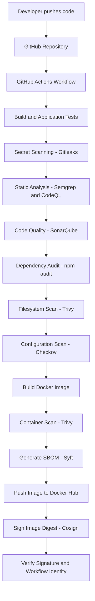

# SecureTask — Shift-Left DevSecOps CI/CD Pipeline

[](#-cicd-pipeline)
[](#-container-hardening)
[](#-security-controls)
[](#-container-image-signing-with-cosign)

**SecureTask** is a hands-on DevSecOps portfolio project demonstrating how to integrate security into a CI/CD pipeline, from source-code validation to container scanning, SBOM generation, image publishing, and cryptographic image signing.

The application is intentionally small. The focus is on secure software delivery: detecting issues early, hardening the container, producing an identifiable image artifact, and verifying its provenance.

> **Project scope:** This documentation covers the project through Docker image publication and Cosign signing/verification. Kubernetes, Argo CD, GitOps deployment, and cluster admission control are intentionally excluded.

---

## Table of Contents

- [1. Project Objectives](#1-project-objectives)
- [2. Architecture](#2-architecture)
- [3. Technology Stack](#3-technology-stack)
- [4. Application Overview](#4-application-overview)
- [5. CI/CD Pipeline](#5-cicd-pipeline)
- [6. Security Controls](#6-security-controls)
- [7. Vulnerabilities and Issues Found](#7-vulnerabilities-and-issues-found)
- [8. Container Hardening](#8-container-hardening)
- [9. Container Image Signing with Cosign](#9-container-image-signing-with-cosign)
- [10. Verification Results](#10-verification-results)
- [11. Repository Structure](#11-repository-structure)
- [12. Run Locally](#12-run-locally)
- [13. Interview Explanation](#13-interview-explanation)
- [14. Screenshots and Evidence](#14-screenshots-and-evidence)
- [15. Future Improvements](#15-future-improvements)

---

## 1. Project Objectives

The objective was to build a practical CI/CD pipeline where security checks are part of the development workflow rather than a final step after release.

The project demonstrates how to:

1. Run automated application tests.
2. Detect accidentally committed secrets.
3. Perform static application security analysis.
4. Check application dependencies for known vulnerabilities.
5. Scan source files and container images.
6. Check Docker and infrastructure configuration against security policies.
7. Build a hardened multi-stage Docker image.
8. Generate a Software Bill of Materials (SBOM).
9. Publish a container image to Docker Hub.
10. Sign the exact image digest using keyless Cosign signing and GitHub Actions OIDC.
11. Verify that the image signature belongs to the expected GitHub Actions workflow identity.

### Why Shift-Left Security?

Finding a security issue before an artifact is published is usually easier and less expensive than discovering it after release.

This pipeline runs multiple security checks during CI so potential issues can be investigated and fixed earlier.

---

## 2. Architecture

### CI/CD Workflow



### Pipeline Design

The GitHub Actions workflow is defined in:

```text
.github/workflows/ci.yml
```

The workflow is configured for the `main` and `develop` branches, pull requests, and manual execution.

The diagram shows the overall security and delivery flow. The exact job order and execution conditions are defined in the workflow file.

---

## 3. Technology Stack

| Area | Technology | Purpose |
|---|---|---|
| Application | Node.js, Express.js, EJS | Web application used as the pipeline workload |
| Testing | Node.js built-in test runner | Automated application tests |
| Source Control | Git and GitHub | Version control |
| CI/CD | GitHub Actions | Automates build, security checks, and image delivery |
| Secret Scanning | Gitleaks | Detects exposed secrets |
| Static Analysis | Semgrep | Rule-based source-code security analysis |
| Semantic Analysis | CodeQL | Deeper source-code analysis |
| Code Quality | SonarQube | Code-quality analysis and quality gate |
| Dependency Security | npm audit | Checks npm dependencies for known advisories |
| Vulnerability Scanning | Trivy | Scans source files and container images |
| Configuration Scanning | Checkov | Checks Docker and supported configuration files |
| Containerization | Docker | Builds the application image |
| SBOM | Syft | Generates software component inventory |
| Image Registry | Docker Hub | Stores the published image |
| Image Signing | Sigstore Cosign | Signs and verifies the container image |

---

## 4. Application Overview

SecureTask is a small Node.js / Express.js application using EJS templates.

The application is intentionally simple so that the project can focus on security automation and container delivery rather than complex business logic.

### Health Endpoint

The application exposes:

```http
GET /health
```

Expected response:

```json
{
  "status": "UP",
  "application": "SecureTask",
  "version": "1.0.0"
}
```

The endpoint is used by the Docker `HEALTHCHECK` instruction to determine whether the application is responding.

### Application Hardening

The Express application disables the `X-Powered-By` response header to avoid unnecessarily disclosing the framework through that header.

---

## 5. CI/CD Pipeline

The GitHub Actions workflow performs application validation and security checks before publishing the container image.

### Pipeline Stages

| Stage | Tool | Purpose |
|---|---|---|
| Source Checkout | actions/checkout | Retrieves repository source code |
| Build and Test | Node.js / node --test | Installs dependencies and runs tests |
| Secret Scanning | Gitleaks | Detects accidentally committed secrets |
| Static Analysis | Semgrep | Detects insecure code patterns |
| Semantic Analysis | CodeQL | Analyzes source code for security issues |
| Code Quality | SonarQube | Evaluates code quality and configured quality gate |
| Dependency Audit | npm audit | Checks npm dependencies against known advisories |
| Filesystem Scan | Trivy | Scans source tree for vulnerabilities, secrets, and misconfiguration |
| Configuration Scan | Checkov | Checks Dockerfile and supported configuration files |
| Container Build | Docker | Builds the multi-stage container image |
| Image Scan | Trivy | Scans the built image for vulnerabilities |
| SBOM Generation | Syft | Generates software component inventory |
| Image Publishing | Docker Hub | Publishes the image to the registry |
| Image Signing | Cosign | Signs the published image digest |
| Signature Verification | Cosign | Verifies the image signature and expected identity |

**Pipeline configuration note:** The Trivy filesystem scan was configured as report-only during this project. Do not describe that particular scan as a blocking security gate. The actual exit-code and job conditions in the workflow determine which checks block publication.

### Pinning GitHub Actions

The workflow originally used a floating action reference:

**Original:**

```yaml
uses: actions/checkout@v4
```

**Updated:**

```yaml
uses: actions/checkout@3d3c42e5aac5ba805825da76410c181273ba90b1
```

**Why this matters:**

A version tag such as `@v4` is convenient, but it is a movable reference. Pinning an action to a full commit SHA makes the action reference immutable and improves CI supply-chain reproducibility.

The same principle was applied to third-party actions where configured.

---

## 6. Security Controls

### 6.1 Secret Detection — Gitleaks

Gitleaks scans the repository for patterns that may indicate exposed credentials, API keys, or tokens.

**Security value:** Helps prevent accidental secret disclosure from going unnoticed during development.

### 6.2 Static Analysis — Semgrep and CodeQL

Semgrep and CodeQL analyze application source code using different approaches.

- Semgrep uses configurable rules to identify suspicious or insecure code patterns.
- CodeQL builds a semantic representation of the code and analyzes it for security issues.

**Security value:** Helps identify potential application weaknesses before the code is released.

### 6.3 Code Quality — SonarQube

SonarQube evaluates maintainability and configured quality-gate conditions.

**Security value:** Adds a code-quality checkpoint alongside dedicated security analysis. A quality gate is not a replacement for vulnerability scanning.

### 6.4 Dependency Security — npm audit

`npm audit` checks the project's npm dependency tree against known security advisories.

**Security value:** Helps identify vulnerable third-party packages included in the application.

### 6.5 Filesystem and Image Scanning — Trivy

Trivy is used at two different points:

- Filesystem scan: examines the source repository for vulnerabilities, secrets, and misconfiguration.
- Image scan: examines packages included in the built container image.

**Security value:** Checks both the source workspace and the final container artifact.

### 6.6 Configuration Scanning — Checkov

Checkov evaluates supported configuration files against security policies.

During this project, Checkov identified a Dockerfile health-check issue under policy `CKV_DOCKER_2`, which was fixed by adding a Docker `HEALTHCHECK` instruction.

---

## 7. Vulnerabilities and Issues Found

This section documents issues encountered during development. It distinguishes security findings from CI integration and troubleshooting issues.

### 7.1 Trivy — Vulnerable Container Dependencies

An earlier Trivy image scan reported:

- **6 HIGH vulnerabilities**
- **0 CRITICAL vulnerabilities**

The findings included vulnerable versions of `brace-expansion` and `undici`.

| Package | Earlier detected version | Finding / Remediation |
|---|---:|---|
| brace-expansion | 5.0.9 | Trivy reported CVE-2026-102276 and CVE-2026-102278. The dependency was updated; the project later showed version 5.0.12 in its dependency tree. |
| undici | 6.28.0 | The earlier image contained this version. The project dependency was updated to the `^8.12.3` range. |

**How the issue was addressed**

1. Reviewed the Trivy image scan report.
2. Identified the affected packages and versions.
3. Updated the project dependency declarations.
4. Rebuilt the Docker image.
5. Re-ran the pipeline and image checks.

The versions above are historical findings from an earlier image scan. They are not a statement that the final image still contains those vulnerable versions. Use the latest scan report to describe the final image's status.

### 7.2 Checkov — CKV_DOCKER_2: Missing Docker HEALTHCHECK

**Finding:**

```text
CKV_DOCKER_2 – Ensure that HEALTHCHECK instructions have been added to container images.
```

Checkov flagged that the Dockerfile did not define a health check.

**Why it matters:**

Without a container health check, the container runtime does not have a Docker-level health signal to distinguish a running process from an application that is not responding as expected.

**What was changed:**

- Added a Docker `HEALTHCHECK` instruction.
- Configured periodic checks against the application's `/health` endpoint.
- Kept the application running as the non-root `node` user.
- Re-ran Checkov to validate the Dockerfile.

Illustrative Dockerfile instruction:

```dockerfile
HEALTHCHECK --interval=30s --timeout=3s --start-period=5s --retries=3 \
  CMD node -e "fetch('http://127.0.0.1:3000/health').then(r => process.exit(r.ok ? 0 : 1)).catch(() => process.exit(1))"
```

The final Dockerfile in the repository is the source of truth for the exact health-check configuration.

**Result recorded during the project:**

```text
Passed checks: 87
Failed checks: 0
Skipped checks: 0
```

This result applies to the Checkov run performed against the project configuration at that point in time.

### 7.3 Semgrep — Initial Findings During Setup

The initial Semgrep run reported 15 blocking findings across 10 tracked files while evaluating approximately 240 rules.

The findings were investigated during pipeline development. Semgrep was subsequently integrated as a CI job, and a later pipeline run completed successfully.

Do not describe all initial findings as confirmed exploitable vulnerabilities without reviewing their individual rule IDs and source locations. Static-analysis findings require triage; some may be true positives, code-quality issues, or false positives.

### 7.4 Docker Hub — Insufficient Token Scope

**Problem:**

The Docker image push failed with an insufficient-scope error.

**Resolution:**

Docker Hub authentication was corrected to use an access token with the required read/write permissions. The image push then succeeded.

**Learning:**

A successful local Docker build does not guarantee that registry credentials have permission to publish the image. Registry authentication and authorization must be validated independently.

### 7.5 Cosign — Version and Signature Verification Compatibility

During implementation, a newer Cosign setup caused signature discovery/verification problems.

**Resolution:**

The workflow was pinned to a compatible Cosign installer action revision and Cosign release `v2.5.3`. The project then successfully signed and verified the published image.

**Learning:**

Security tooling versions and signature-storage behavior matter. Validate the complete sign-and-verify process using the exact image digest rather than assuming that a successful signing command alone proves verification works.

### 7.6 GitHub Actions Image Digest Extraction — Incorrect Output Field

**Problem:**

The Docker push output was parsed with `awk` using field `$2`:

```bash
DIGEST="$(awk '/digest: sha256:/ {print $2}' docker-push.log | tail -n 1)"
```

The digest was actually in field `$3`, so the workflow could extract the wrong value.

**Fix:**

The command was corrected to:

```bash
DIGEST="$(awk '/digest: sha256:/ {print $3}' docker-push.log | tail -n 1)"
```

**Why this matters:**

The pipeline must sign and publish the exact digest returned by the registry. Extracting the wrong field can break downstream signing or verification.

**Learning:**

Inspect real command output before parsing it. When a pipeline depends on CLI output, validate the selected field and fail clearly if the expected digest is missing or malformed.

### 7.7 GitHub Actions — Pinning Checkout to a Commit SHA

**Original reference:**

```yaml
uses: actions/checkout@v4
```

**Updated reference:**

```yaml
uses: actions/checkout@3d3c42e5aac5ba805825da76410c181273ba90b1
```

**Why this matters:**

A version tag can move. A full commit SHA is an immutable reference to a specific action revision, improving reproducibility and reducing risk from unexpected changes to a tag.

---

## 8. Container Hardening

The Dockerfile uses a multi-stage build to keep build-time dependencies out of the final runtime image.

### Implemented Controls

- Uses a pinned Node.js Alpine base-image version.
- Separates dependency installation, test execution, production dependencies, and runtime stages.
- Runs tests as part of the image build workflow.
- Uses the unprivileged `node` user (UID/GID 1000) for runtime.
- Removes npm and npx from the final runtime image.
- Exposes application port `3000`.
- Adds a Docker `HEALTHCHECK` against `/health`.
- Starts the application with Node.js.

### Why Multi-Stage Builds?

A multi-stage Dockerfile allows build and test dependencies to remain in earlier stages. The final image contains the application and production dependencies it needs to run, reducing unnecessary tools and packages in the runtime image.

### Why Run as Non-Root?

If an application process is compromised, running it as an unprivileged user reduces the permissions available to that process compared with running as root.

It is one layer of defense, not a guarantee that the application is secure.

---

## 9. Container Image Signing with Cosign

After the image is built, scanned, and pushed to Docker Hub, the workflow signs the immutable image digest using Sigstore Cosign.

### Keyless Signing with GitHub Actions OIDC

The workflow uses GitHub Actions OIDC to obtain an identity token. Cosign uses this identity to create a keyless signature and certificate.

This avoids storing a long-lived private signing key in GitHub repository secrets.

### Verification Identity

The verification is restricted to the expected workflow identity associated with:

**Repository:**

```text
sb-sachinborse/devsecops-sdp
```

**Workflow:**

```text
.github/workflows/ci.yml
```

**OIDC issuer:**

```text
https://token.actions.githubusercontent.com
```

The workflow identity regular expression used for verification is:

```text
^https://github.com/sb-sachinborse/devsecops-sdp/\.github/workflows/ci\.yml@refs/heads/(main|develop)$
```

### Example Verification Command

The project verified the published image using the expected certificate identity and OIDC issuer:

```bash
cosign verify \
  --certificate-identity-regexp '^https://github.com/sb-sachinborse/devsecops-sdp/\.github/workflows/ci\.yml@refs/heads/(main|develop)$' \
  --certificate-oidc-issuer 'https://token.actions.githubusercontent.com' \
  docker.io/mavrickdocker/securetask@sha256:c7b595a99f99e512a339e7a1be438ded7b2bcf5bc8ab092e6c51ec4a21889f41
```

### What This Verifies

- The image digest has a verifiable Cosign signature.
- The certificate identity matches the expected GitHub Actions workflow pattern.
- The certificate issuer matches GitHub Actions OIDC.

A signature establishes provenance information for the artifact. It does not by itself prove that the source code is vulnerability-free.

### Why Sign the Digest?

A mutable image tag can be moved to point to different image content. A digest identifies the exact image artifact.

Signing and verifying the digest ties the provenance check to that specific artifact.

---

## 10. Verification Results

The following are results observed during the project. They are point-in-time evidence, not a guarantee about future builds.

| Area | Observed Result |
|---|---|
| GitHub Actions | Pipeline completed successfully |
| Gitleaks | CI job completed successfully |
| Semgrep | CI job completed successfully in a later run |
| CodeQL | CI job completed successfully |
| SonarQube | Integrated into pipeline; refer to the successful run for the quality-gate result |
| npm audit | Integrated into pipeline; refer to the run report for detailed advisory counts |
| Trivy filesystem scan | Configured as report-only |
| Checkov | 87 passed, 0 failed, 0 skipped in the recorded local run |
| Earlier Trivy image scan | 6 HIGH, 0 CRITICAL; affected dependency versions were subsequently updated |
| Docker Hub | Image push succeeded after correcting token scope |
| Syft | SBOM generation included in the pipeline |
| Cosign | Keyless signing and local verification succeeded |

### Published Image Reference

The image digest used during the verified workflow and subsequent project testing was:

```text
docker.io/mavrickdocker/securetask@sha256:c7b595a99f99e512a339e7a1be438ded7b2bcf5bc8ab092e6c51ec4a21889f41
```

Use the current workflow run and registry metadata when discussing newer image builds. This digest is a record of the artifact used during the documented project milestone.

---

## 11. Repository Structure

```text
devsecops-sdp/
├── .github/
│   └── workflows/
│       └── ci.yml
├── public/
├── src/
│   ├── app.js
│   └── server.js
├── views/
├── Dockerfile
├── package.json
├── package-lock.json
└── README.md
```

The application repository contains:

- Node.js application source
- EJS views and static assets
- Application tests
- Docker multi-stage build definition
- GitHub Actions CI/CD and security workflow
- Project documentation

---

## 12. Run Locally

### Prerequisites

- Git
- Node.js version compatible with the `engines` field in `package.json`
- npm
- Docker (optional, for container build and run)

### Clone and Test

```bash
git clone https://github.com/sb-sachinborse/devsecops-sdp.git
cd devsecops-sdp

npm ci
npm test
```

### Run the Application

```bash
npm start
```

Open:

```text
http://localhost:3000
```

Health endpoint:

```text
http://localhost:3000/health
```

### Build the Container

```bash
docker build -t securetask:local .
```

Run it:

```bash
docker run --rm -p 3000:3000 securetask:local
```

Check the health endpoint:

```bash
curl -i http://localhost:3000/health
```

---


### Embedding Screenshots

After capturing the images, embed them in the README using Markdown:

```markdown
### Successful CI pipeline


### Checkov results


### Dockerfile health check


### Cosign verification

```

Only add screenshots that you have actually captured. Do not use mock screenshots or images that imply a check passed when it did not.

---

## 15. Future Improvements

The project is being closed at the successful CI, image publication, and Cosign verification milestone.

These are optional future improvements, not features claimed as completed:

- Configure explicit blocking thresholds for selected Trivy findings after deciding on severity and exception policy.
- Preserve SBOM and scan reports as versioned CI artifacts.
- Add vulnerability policy management and documented exception handling.
- Add image provenance/attestation verification in addition to signature verification.
- Add automated dependency update pull requests.
- Review action pin updates regularly and document the update process.
- Add a release process that promotes a verified immutable image digest.

---

## Project Repository

**Application and CI/CD pipeline:**

https://github.com/sb-sachinborse/devsecops-sdp

---

## Final Note

The value of this project is not the number of tools in the workflow. It is the ability to explain:

- What each security check does.
- Which findings were actually observed.
- How the findings were investigated and fixed.
- How the final image was built and scanned.
- How the SBOM improves component visibility.
- How Cosign verifies the identity associated with the published image.

A clear explanation backed by real pipeline logs, scan reports, and signature-verification output is stronger than simply listing DevSecOps tools.
